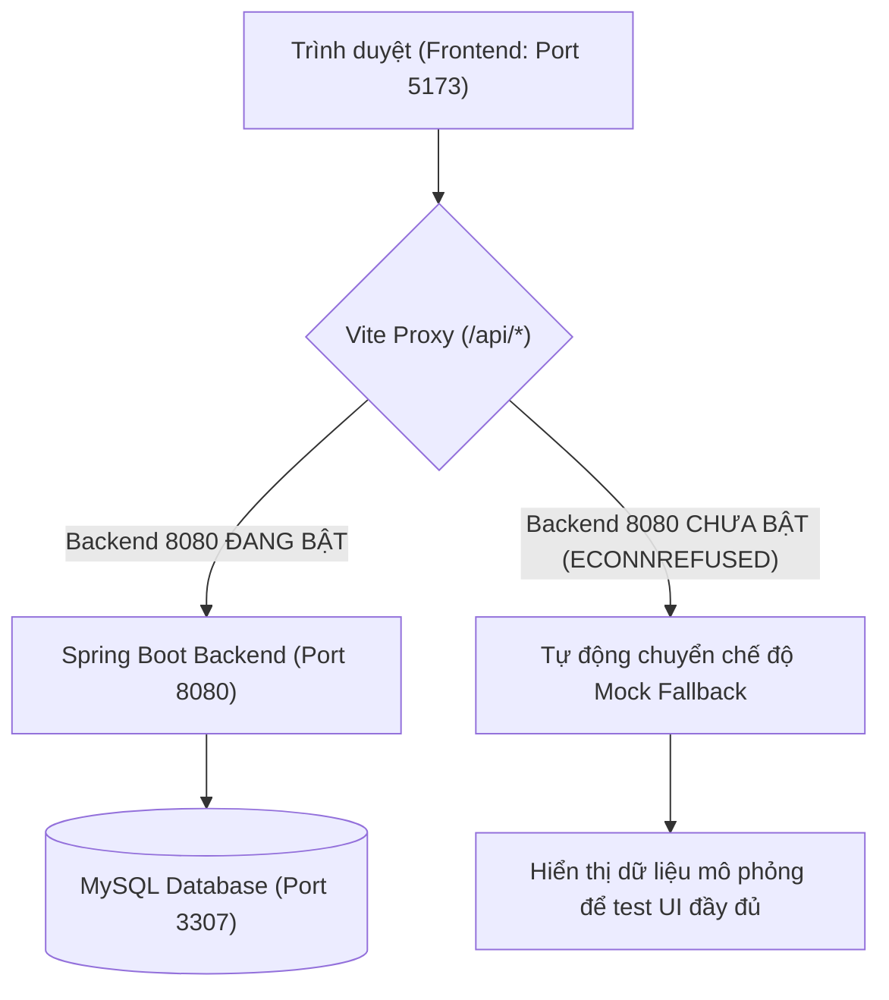

# Hướng dẫn chạy Frontend — Phân hệ Bệnh nhân (Patient Portal)

**Phụ trách:** Vũ Trần Khắc Thuận (MSSV: 52400243)  
**Công nghệ:** React 18, TypeScript, Vite, React Router v6, react-oidc-context  
**Thư mục mã nguồn:** `frontend/`

---

## 1. Yêu cầu môi trường

- **Node.js:** Phiên bản `>= 18.x` (khuyến nghị bản LTS 20.x hoặc 22.x).
- **npm:** Đi kèm khi cài Node.js (phiên bản `>= 9.x`).
- **Trình duyệt web:** Google Chrome, Microsoft Edge hoặc Mozilla Firefox hiện đại.

> [!NOTE]
> Nếu chạy trên PowerShell của Windows mà gặp lỗi script bị chặn (`Execution_Policies`), mở PowerShell và chạy lệnh sau để mở quyền thực thi:
> ~~~powershell
> Set-ExecutionPolicy -Scope CurrentUser -ExecutionPolicy RemoteSigned -Force
> ~~~

---

## 2. Hướng dẫn cài đặt và khởi chạy

Mở cửa sổ terminal (PowerShell hoặc Command Prompt) từ thư mục gốc của dự án:

### Bước 1: Di chuyển vào thư mục frontend
~~~powershell
cd frontend
~~~

### Bước 2: Cài đặt các gói phụ thuộc (chỉ cần chạy lần đầu)
~~~powershell
npm install
~~~

### Bước 3: Khởi động máy chủ phát triển (Dev Server)
~~~powershell
npm run dev
~~~

Sau khi chạy lệnh trên, terminal sẽ xuất hiện đường dẫn:
```text
  VITE v5.4.10  ready in 250 ms

  ➜  Local:   http://localhost:5173/
  ➜  Network: use --host to expose
```

Nhấn giữ phím `Ctrl` và click vào đường dẫn `http://localhost:5173` (hoặc mở trình duyệt nhập địa chỉ trên) để truy cập cổng bệnh nhân.

---

## 3. Cơ chế kết nối API và hai chế độ hoạt động

Frontend phân hệ bệnh nhân được thiết kế linh hoạt hỗ trợ **2 chế độ vận hành song song**:



### A. Chế độ độc lập (Standalone / Demo Mock Mode)
- **Khi nào áp dụng:** Khi máy tính của bạn hoặc thành viên nhóm chưa bật Docker, MySQL hoặc Backend Spring Boot.
- **Cách thức hoạt động:** Khi gửi request đến `/api/*` bị từ chối kết nối, frontend sẽ tự động kích hoạt chế độ **Fallback dữ liệu mẫu**. Tất cả các màn hình (đặt lịch, đổi/hủy lịch, hồ sơ, đơn thuốc, video call...) vẫn hoạt động trơn tru để phục vụ demo và kiểm thử giao diện.
- **Lưu ý về terminal:** Khi chạy ở chế độ này, terminal của Vite sẽ hiện log đỏ `[vite] http proxy error: ... ECONNREFUSED`. **Đây là thông báo bình thường** của Vite khi không tìm thấy backend cổng 8080, không làm ảnh hưởng hay sập ứng dụng web.

### B. Chế độ tích hợp toàn trình (Live Backend Mode)
- **Khi nào áp dụng:** Khi đã khởi chạy toàn bộ dịch vụ backend theo tài liệu [running.md](running.md) bằng lệnh:
  ~~~powershell
  # Từ thư mục gốc SE-project:
  ./scripts/setup-local.ps1
  docker compose up -d --build
  ~~~
- **Cách thức hoạt động:** Vite proxy sẽ tự động chuyển tiếp request `/api/*` sang `http://localhost:8080/api/*`. Dữ liệu lịch hẹn, tài khoản và slot khám sẽ được đọc/ghi trực tiếp vào MySQL Database. Các dòng cảnh báo `ECONNREFUSED` trên terminal sẽ hoàn toàn biến mất.

---

## 4. Danh mục màn hình và đường dẫn (Routes)

| Đường dẫn | Màn hình | Chức năng chính |
|---|---|---|
| `/login` | **Đăng nhập hệ thống** | Hỗ trợ đăng nhập qua Keycloak OIDC (PKCE) hoặc đăng nhập nhanh tài khoản Bệnh nhân Demo (`patient` / `demo123`). |
| `/callback` | **Xử lý OIDC Callback** | Tiếp nhận Authorization Code và trao đổi Bearer access token lưu vào phiên làm việc. |
| `/patient` | **Trang chủ bệnh nhân** | Dashboard thống kê tổng quan lịch khám sắp tới, đơn thuốc, giờ hệ thống (`Asia/Ho_Chi_Minh`) và nút truy cập nhanh. |
| `/patient/booking` | **Đặt lịch khám** | Quy trình 3 bước (Chuyên khoa → Bác sĩ → Giờ khám), tự động sinh `Idempotency-Key`, tự động tải lại khung giờ khi bị tranh chấp (lỗi 409) và giữ nguyên bộ lọc. |
| `/patient/appointments` | **Lịch khám của tôi** | Danh sách lịch, bộ lọc hình thức/trạng thái; hỗ trợ **Đổi lịch** và **Hủy lịch** có xác nhận và tự động kiểm tra điều kiện mốc thời gian (ít nhất 2 giờ trước giờ khám). |
| `/patient/records` | **Hồ sơ & Đơn thuốc** | Xem lịch sử các lần khám đã hoàn tất (FINAL), xem chẩn đoán, lời dặn của bác sĩ và bảng chi tiết đơn thuốc điện tử (chỉ đọc). |
| `/patient/telehealth` | **Phòng khám từ xa** | Chuẩn bị phiên, kiểm tra thực tế Camera/Micro qua Media Stream API, xác nhận tham gia phòng chờ, giả lập kết nối cuộc gọi và điều khiển rời phòng an toàn. |

---

## 5. Quy chuẩn kỹ thuật giao diện

- **Màu sắc & Giao diện:** Đồng bộ tuyệt đối theo bản mẫu thiết kế HTML [clinic-telehealth-full-prototype.html](design/gui-mockups/clinic-telehealth-full-prototype.html).
- **Hệ thống Icon:** Sử dụng chuẩn Unicode biểu tượng y tế theo mockup (`✚`, `⌂`, `＋`, `▣`, `▤`, `◉`, `✓`, `✉`).
- **Định dạng hiển thị bác sĩ:** Chuẩn hóa theo quy ước: `BS. Tên Bác Sĩ (Chuyên khoa)` (ví dụ: *BS. Nguyễn Minh Anh (Nội tổng quát)*).
- **Typography & Font chữ:** Nhúng bộ font Google Fonts **Inter** chuẩn tiếng Việt, cấu hình `font-synthesis: none` và `text-rendering: optimizeLegibility` giúp chống nhòe nét và không bị biến dạng ký tự tiếng Việt có dấu khi tương tác.
- **Múi giờ:** Toàn bộ thời gian hiển thị được format theo múi giờ chuẩn Việt Nam `Asia/Ho_Chi_Minh` (UTC+7).

---

## 6. Lệnh kiểm thử và đóng gói bản phát hành

Từ thư mục `frontend`:

- **Kiểm tra kiểu dữ liệu TypeScript (Type check):**
  ~~~powershell
  npx tsc --noEmit
  ~~~
  *(Yêu cầu kết quả: 0 lỗi compile).*

- **Đóng gói bản phát hành (Production build):**
  ~~~powershell
  npm run build
  ~~~
  *(Mã nguồn tối ưu sau khi build sẽ nằm trong thư mục `frontend/dist/` sẵn sàng triển khai).*

- **Dừng máy chủ phát triển:**
  Nhấn tổ hợp phím **`Ctrl + C`** trong cửa sổ terminal đang chạy server, sau đó gõ `y` và nhấn Enter.
